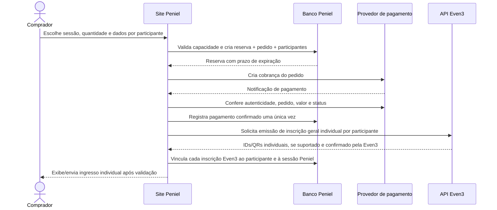

# Fluxo de compra, ingresso Even3 e scanner no evento

**Registro de decisão e especificação para a branch oficial**<br>
**Data:** 18/10/2026<br>
**Escopo:** compra no site Peniel, emissão de ingresso geral individual na Even3, vínculo da sessão em banco Peniel e check-in no evento.<br>
**Estado:** arquitetura proposta; integração Even3 e pagamento ainda precisam de homologação técnica.

> **Atualização da recomendação:** para o fluxo de compra mais simples, consulte primeiro [`DECISAO_CHECKOUT_HIBRIDO_EVEN3.md`](DECISAO_CHECKOUT_HIBRIDO_EVEN3.md). A hipótese atual é selecionar a data no site Peniel e direcionar ao link de pagamento de uma entrada Even3 correspondente à sessão. Este documento continua registrando a alternativa em que o checkout, a reserva e o pagamento ficam inteiramente no site Peniel.

## 1. Objetivo confirmado

A pessoa deve conseguir concluir a jornada de compra no site Peniel:

1. Escolher o dia da apresentação.
2. Escolher a quantidade de ingressos.
3. Preencher os dados individuais de cada integrante.
4. Pagar no checkout do site.
5. Receber um QR individual por participante. **Preferência do projeto:** QR Even3; emissão pós-pagamento externo ainda depende de confirmação técnica.

A Even3 terá um ingresso geral, sem inscrição obrigatória em atividade. A data escolhida será informação operacional do Peniel, armazenada no banco e ligada a cada inscrição/ingresso Even3. Na portaria, o sistema Peniel decide se o QR pertence à sessão do dia e se ainda não foi utilizado.

## 2. Decisão anterior para a alternativa de pagamento Peniel

> A recomendação atual para o checkout híbrido está em [`DECISAO_CHECKOUT_HIBRIDO_EVEN3.md`](DECISAO_CHECKOUT_HIBRIDO_EVEN3.md). As decisões e estimativas abaixo descrevem a alternativa de processar o checkout integralmente no site Peniel.

**Um pedido corresponde a uma sessão.** A pessoa escolhe um dia e essa sessão é aplicada a todos os ingressos do pedido. Se precisar de ingressos para dias diferentes, cria pedidos separados.

Essa regra simplifica a reserva atômica de capacidade, reduz erros ao preencher os dados do grupo e deixa claro qual sessão a equipe está operando. Mesmo assim, cada ingresso individual deve guardar a sua própria `session_date`; o dia não deve existir somente no cabeçalho do pedido.

Valores e capacidade encontrados no código da branch de migração `migracao/site-oficial-20261017`:

- Ingresso: **R$ 15,00 + 1 kg de alimento não perecível por pessoa**.
- Limite online: **210 pessoas por sessão**.
- Limite total: **300 pessoas por sessão**. A diferença de 90 lugares parece ser a cota presencial; confirmar com a coordenação antes de anunciar como regra.
- Datas e abertura dos portões: 09/11/2026 (17h), 13/11/2026 (20h), 14/11/2026 (18h), 19/11/2026 (20h), 20/11/2026 (17h) e 21/11/2026 (18h).

Como a Even3 terá um ingresso geral sem sessões, ela não controla o limite de cada dia escolhido no site. O estoque diário é responsabilidade do banco Peniel. A reserva deve bloquear a linha da sessão em transação, considerar pedidos pagos e reservas ainda válidas, e liberar reservas expiradas.

## 3. Fluxo de compra proposto para a alternativa Peniel



### Regras do pedido e do pagamento

- O preço é calculado no servidor, nunca aceito do navegador como valor confiável.
- O webhook do meio de pagamento precisa ser autenticado e idempotente; confirmar o pagamento após validar provedor, pedido, valor e moeda.
- Nunca criar ingresso válido a partir de retorno do navegador ou de um webhook não verificado.
- Se o pagamento foi aprovado, mas a emissão Even3 falhou, marcar `emissao_pendente`, tentar novamente com idempotência e manter a reserva do pedido. Não cobrar novamente.
- Se o pagamento for tardio depois da expiração ou após a vaga ter sido liberada, encaminhar para conciliação e reembolso supervisionado; não emitir ingresso automaticamente sem capacidade.
- Cancelamento e reembolso devem invalidar o ingresso local assim que confirmados.

## 4. O que a documentação Even3 confirma para checkout integral no Peniel

Consultei a documentação pública oficial atual em 18/10/2026. **A ideia de manter data, quantidade, participantes e reserva no checkout Peniel é correta. O ponto ainda não comprovado é emitir, depois de pagamento externo, um ingresso geral Even3 que tenha um QR válido no scanner oficial.**

O que está documentado:

1. A API V2 possui `POST /api/v2/attendees/create`, que cria um participante. O exemplo apresenta nome, e-mail, gênero, foto e `registration_confirmed: false`, mas não mostra preço/entrada, venda externa, referência de pagamento, `check_in_code` retornado nem garantia de QR.
2. A API V2 permite consultar participantes. A resposta de listagem/detalhe documenta `id`, `event_id`, `check_in_code`, `is_confirmed` e categoria da inscrição. Isso permite conciliar participantes já existentes; não prova que o `POST` acima faça uma inscrição paga ou emita um QR escaneável.
3. A API V2 documenta check-in em **atividade** (`POST /api/v2/checkin/sessions`). Não encontrei um endpoint V2 público documentado para check-in geral no evento.
4. A API V1, explicitamente marcada como depreciada e sem novas funcionalidades, documenta `POST /attendees/create` com entrada e preço (`registration.id_ticket_price`, `registration.price`) e `registration_confirmed`. Também documenta check-in geral por `POST /checkin/attendees`, usando `checkin_code`.
5. A Even3 diz que inscrição confirmada não comprova pagamento: inscrição pode ser gratuita, paga ou manual. Portanto `registration_confirmed: true` **não pode ser usado como prova de cobrança recebida**.
6. Os webhooks Even3 de venda notificam ações que ocorreram na própria Even3 (aprovada, reprovada, cancelada/reembolsada). O webhook de inscrição confirmada é independente do pagamento. Eles podem ser reenviados, então o `id` do disparo deve ser idempotente. Um webhook não cria uma venda nem um ingresso Even3 para uma compra cobrada no Peniel.

Assim, a conclusão precisa é: **a documentação pública não comprova que seja possível entregar ingresso/QR oficial Even3 após cobrar no Peniel**. Existe um endpoint V2 para criar participante e um endpoint V1 legado mais amplo para criar inscrição em ingresso, mas nenhum deles, pela documentação consultada, confirma uma venda externa nem garante o fluxo completo com QR oficial. Isso é uma lacuna de comprovação, não prova de que a Even3 não ofereça uma solução privada/contratual para a conta.

### Confirmações a pedir à Even3 ou testar no evento gratuito de homologação

1. `POST /api/v2/attendees/create` gera inscrição e QR de entrada geral? Como buscar o `check_in_code` ou QR gerado logo após a chamada?
2. Como o organizador cria uma inscrição individual paga quando o pagamento ocorreu fora da Even3? A API V1 ainda é autorizada para esse caso e continuará funcionando durante o evento?
3. É possível emitir **N inscrições individuais** para uma compra Peniel, com identificadores estáveis e sem criar uma venda financeira fictícia na Even3?
4. O mesmo e-mail pode ser usado para vários integrantes? Quais campos são realmente obrigatórios para cada pessoa?
5. O scanner oficial aceita esse tipo de inscrição? O que acontece com QR inexistente, cancelado e já credenciado?
6. Para atualizar check-in geral pela API, a rota V1 `/checkin/attendees` segue operacional? Há endpoint V2 geral ou API contratual? Qual a resposta quando o código já foi usado?
7. O plano da conta da igreja habilita API, webhooks, emissão externa e suporte a esses endpoints?

### Mensagem pronta para o suporte Even3

> Olá! Somos os organizadores do evento Casa do Julgamento 2026 (evento Even3 798621). Queremos vender no nosso próprio site, onde o comprador escolhe uma sessão e informa os dados individuais de cada participante. O pagamento seria processado no nosso site e a Even3 teria uma entrada geral, sem atividade/data. A API V2 documenta `POST /api/v2/attendees/create`, mas o exemplo não mostra entrada paga nem `check_in_code`; a API V1 documenta cadastro com entrada e check-in geral, mas aparece como depreciada. Qual é o fluxo atualmente suportado para, após um pagamento externo confirmado, criar uma inscrição geral individual com QR aceito pelo aplicativo/scanner oficial? Precisamos de uma inscrição por pessoa, consulta do identificador/QR e endpoint atual para marcar o check-in geral. A API V1 ainda pode ser usada em produção para esse fluxo? O plano do nosso evento tem acesso a isso? Também precisamos saber se o e-mail pode ser igual para vários participantes e como cancelamentos/reembolsos invalidam as inscrições.

### O que o ingresso gratuito de teste consegue provar

Criar um lote gratuito privado para uma sessão de teste e emitir 1 ingresso, depois 2 no mesmo pedido, é um bom teste de cadastro, QR e leitura. Deve-se verificar o ID/código de cada pessoa na API, escanear pelo app oficial, tentar ler duas vezes e observar os webhooks de inscrição e check-in.

Esse teste **não** valida recebimento PIX/cartão, webhook de venda aprovada, chargeback, reembolso nem corrida pela última vaga. Além disso, Even3 informa que eventos gratuitos não geram gatilhos de venda; deve-se esperar o webhook de inscrição, não o de venda.

Referências oficiais consultadas:

- [Visão geral da API pública V2](https://developers.even3.com/inicio-2180158m0)
- [Criar participante na API V2](https://developers.even3.com/criar-participante-37474565e0)
- [Listar participantes na API V2](https://developers.even3.com/listar-participantes-37094927e0) e [detalhar participante](https://developers.even3.com/detalhar-participante-37094926e0)
- [Referência V1 e indicação de versão depreciada](https://developers.even3.com/inicio-2282820m0)
- [Gatilhos de participantes](https://developers.even3.com/gatilhos-de-participantes-2281973m0) e [gatilhos de venda](https://developers.even3.com/gatilhos-de-venda-2282082m0)
- [Credenciamento em atividade pela API V2](https://developers.even3.com/credenciar-na-atividade-40615758e0) — não atende à regra escolhida de não usar atividades para data.

## 5. Checkout completo no Peniel — alternativa ao fluxo híbrido

O checkout deve permanecer no domínio Peniel e funcionar sem criar conta. Uma compra aplica **uma data a todos os ingressos**; para datas diferentes, o comprador cria outro pedido. O cliente pode alterar a data antes de reservar. O site mostra o preço de R$ 15 por pessoa e a entrega de 1 kg de alimento por ingresso.

### Estrutura da tela

1. **Cabeçalho e progresso:** “Ingressos → Participantes → Pagamento”, com “Participantes” ativo. Não exigir login.
2. **Sessão:** data, dia da semana, horário de abertura dos portões e endereço. Avisar que abertura dos portões não é o horário da apresentação. Permitir voltar e trocar a data.
3. **Quantidade:** seletor de 1 a 6 ingressos, validado também no servidor. Ao mudar quantidade, adicionar/remover o formulário de cada integrante.
4. **Dados de cada ingresso:** nome completo e e-mail individual. A Even3 exige/espera e-mail no exemplo da API; testar se permite repetir o e-mail do comprador antes de decidir como simplificar. Não solicitar CPF, nascimento ou outros dados sem necessidade comprovada.
5. **Contato do responsável pela compra:** nome, WhatsApp e e-mail para atualizações do pedido. Esse contato não substitui o registro de cada ingresso.
6. **Resumo sempre visível:** data escolhida, quantidade, R$ 15 × quantidade, total, 1 kg de alimento por ingresso e eventual taxa somente se o valor final já for conhecido. No celular, o resumo fica antes do botão.
7. **Reserva e pagamento:** ao pressionar “Continuar para pagamento”, o servidor valida sessão/preço/estoque e cria pedido + participantes numa transação. A reserva expira em 15 minutos. O valor vem do servidor; não pedir dados de cartão diretamente no site. O método PIX só aparece depois que o provedor estiver configurado.
8. **Confirmação:** não mostrar “ingresso emitido” só pelo retorno do navegador. Confirmar pagamento por webhook assinado/consulta ao provedor; em seguida emitir/vincular cada ingresso e mostrar status separado se a emissão Even3 estiver pendente.

### Estados que a tela precisa mostrar

- Sessão sem vagas: informar lotação e permitir escolher outra data.
- Reserva em andamento: evitar duplo clique e manter a mesma chave de idempotência ao recarregar.
- Pagamento pendente: apresentar instruções e prazo de reserva.
- Pagamento confirmado, QR sendo emitido: mostrar “pagamento confirmado; estamos finalizando seus ingressos”, sem gerar nova cobrança.
- Pedido expirado: não prometer vaga; permitir iniciar novo pedido.
- Falha da emissão Even3 após pagamento: manter estado de suporte/retentativa e preservar a vaga; não entregar QR incompleto.

### Exemplo de microcopy

> **Casa do Julgamento 2026**<br>
> Sessão: sábado, 14/11/2026 · Portões às 18h<br>
>
> Escolha quantos ingressos precisa e informe os dados de cada pessoa. Todos os ingressos deste pedido serão para esta data. Para outra data, faça um novo pedido.

> **Cada ingresso:** R$ 15,00 + 1 kg de alimento não perecível.<br>
> A escolha da data fica salva no sistema da Igreja Batista Peniel.

O protótipo visual interativo está em [`CHECKOUT_SITE.html`](CHECKOUT_SITE.html). Ele não cria pedido, reserva vaga, envia dados ou cobra pagamento.

## 6. Scanner próprio Peniel ou scanner oficial Even3

| Critério | Scanner Peniel, ligado ao backend | Scanner oficial Even3 + sincronização |
| --- | --- | --- |
| Confere a data Peniel antes de liberar | Sim; no MVP o QR será Peniel e sua data estará no pedido | O scanner de ingresso geral valida o evento, mas não conhece a data Peniel |
| Evita reutilização em qualquer dia | Sim, com consumo atômico do ingresso na base Peniel | A Even3 pode registrar check-in geral; é preciso confirmar a regra de leitura repetida |
| Atualiza Even3 | A API pública encontrada documenta check-in geral somente na V1 depreciada; a V2 documenta check-in em atividade | A Even3 atualiza seu próprio check-in |
| Dependência | Leitura do conteúdo do QR + API/roster confiável e conectividade com Peniel | App/conta Even3 e webhook/API para sincronizar com Peniel |
| Risco principal | QR proprietário, indisponibilidade da API, integração scanner/API não confirmada | Even3 pode aprovar e marcar o QR antes de Peniel identificar dia errado; webhook é posterior e pode atrasar |

### Recomendação

**Usar o scanner Peniel como autoridade da entrada nos dois fluxos.** No checkout completo Peniel, ele valida o QR Peniel local. No checkout híbrido, ele deve ler o QR Even3 e resolver a inscrição local já sincronizada. O leitor precisa validar a data antes de marcar o uso e liberar a pessoa; essa leitura do QR Even3 precisa ser homologada com ingressos reais de teste. Se não conseguir ler/identificar o QR Even3, emitir também um QR operacional Peniel e explicar ao participante qual QR usar na portaria.

A documentação da Even3 descreve credenciamento geral do evento, sem controle por dia da apresentação, e diz que o check-in geral de um participante só é feito uma vez. A rota pública documentada para check-in geral continua sendo V1 depreciada. Por isso, não depender do app Even3 para decidir se a data da sessão está correta; qualquer sincronização com o check-in oficial é secundária e depende de confirmação técnica.

**Não usar os dois scanners para a mesma pessoa no mesmo momento.** Isso cria dois registros de uso independentes e pode fazer a Even3 marcar um ingresso antes que o Peniel confira o dia.

O scanner oficial Even3 sozinho não valida a sessão Peniel. O webhook de check-in é enviado quando o check-in já foi confirmado, então ele não funciona como autorização síncrona antes da leitura. A equipe teria de manter a pessoa aguardando o resultado Peniel depois que o QR já foi marcado, gerando uma operação sujeita a correção manual.

### Sequência de leitura com scanner Peniel

1. Operador autenticado abre o posto Portaria e escolhe a sessão em operação.
2. A câmera lê o QR do sistema definido como emissor. No MVP atual, esse é o QR Peniel; se houver integração oficial homologada, poderá ser o QR Even3. O navegador envia somente o token ao endpoint autenticado Peniel.
3. O backend resolve o token para um ingresso individual local e, quando aplicável, para o identificador Even3 mapeado. Nunca usa nome/e-mail como chave de leitura.
4. O backend verifica: evento correto, inscrição válida/confirmada, pagamento conforme a regra, não cancelado/reembolsado, sessão Peniel igual à sessão atual e ingresso ainda não consumido.
5. Em uma transação única, o backend marca o ingresso como usado, grava data/hora/operador e cria a chegada na fila da coordenação.
6. Devolve resultado claro: `ENTRADA LIBERADA`, `DIA INCORRETO`, `INGRESSO JÁ UTILIZADO`, `CANCELADO/REEMBOLSADO`, `NÃO LOCALIZADO` ou `AGUARDANDO SINCRONIZAÇÃO`.
7. Se a API Even3 falhar depois da autorização Peniel, manter uma tarefa de sincronização pendente e reconciliar; não inserir duas pessoas na fila.

### Exceções no dia

- **Pago, ativo, data correta, nunca usado:** aceitar.
- **Data diferente:** bloquear e chamar supervisor. A exceção só pode alterar a sessão após conferir capacidade; registrar operador, sessão original, nova sessão, motivo e hora.
- **Já usado em qualquer dia:** bloquear. Uma exceção de data nunca libera um QR já consumido.
- **Cancelado/reembolsado:** bloquear.
- **QR sem vínculo local ou dado Even3 indisponível:** não liberar automaticamente; direcionar à mesa de exceção para conciliação.
- **Perda de internet:** scanner não deve operar em modo multiaparelho com uma lista desatualizada. Definir previamente uma contingência supervisionada e conciliar todos os registros antes de retomar.

## 7. Modelo de dados necessário

O pedido pode agrupar valor e contato do comprador, mas cada participante precisa de um registro de ingresso:

```text
orders
  id, buyer_contact, status, amount_cents, payment_provider_ref,
  created_at, expires_at, paid_at

order_tickets
  id, order_id, session_date, attendee_name, attendee_email/phone (mínimos),
  ticket_status, even3_event_id, even3_attendee_id,
  even3_registration_id, even3_checkin_code_hash,
  issued_at, used_at, used_by

payment_events
  provider, event_id, order_id, payload_hash, received_at

even3_webhook_inbox
  event_id, notification_id, trigger, payload_hash, payload,
  processing_status, received_at, processed_at

ticket_exceptions / audit_log
  ticket_id, original_session, authorized_session, operator_id,
  reason, created_at
```

Regras de integridade:

- IDs de inscrição Even3 únicos por evento.
- Um ingresso local só pode ter uma utilização aceita globalmente.
- A data da sessão é uma data controlada pelo Peniel, não inferida do relógio do telefone.
- Nunca usar e-mail/nome como chave entre pedido, pessoa e inscrição.
- Restringir dados pessoais e tokens às rotas de servidor e às funções de equipe autorizadas; não gravar o conteúdo secreto do QR em logs.
- Atualizações do webhook idempotentes pela identificação única fornecida pela Even3; tratar reenvios e reconciliação.
- Controlar estoque da sessão em transação, com concorrência protegida no banco.

## 8. Alterações necessárias na alternativa de checkout Peniel

Para as mudanças do fluxo híbrido no código oficial, use a lista mais curta e atualizada em [`DECISAO_CHECKOUT_HIBRIDO_EVEN3.md`](DECISAO_CHECKOUT_HIBRIDO_EVEN3.md).

Arquivos observados na branch `migracao/site-oficial-20261017` e direção de mudança:

Na versão analisada, a página por data ainda direciona à Even3 e instrui a pessoa a escolher o dia novamente por lá. A página `dados.jsx` coleta um nome e WhatsApp para o pedido inteiro, não os dados de cada ingresso. `orders.js` já reserva vagas de forma transacional e emite um token/QR local por unidade após pagamento verificado. `payments.js` continua fail-closed: nenhum provedor PIX foi escolhido e cobrança real não está habilitada.

| Área/arquivo | Alteração necessária |
| --- | --- |
| `apps/site-oficial/pages/ingressos/[dia].jsx` | Trocar o link direto para Even3 por seleção de quantidade e abertura do checkout Peniel, preservando a sessão. |
| `apps/site-oficial/pages/checkout.jsx` (nova) | Construir a tela de sessão, quantidade, dados por pessoa, contato do comprador, resumo e próximos estados do pedido. O HTML desta pasta é referência visual. |
| `apps/site-oficial/pages/dados.jsx` | Substituir ou redirecionar para o novo checkout; hoje envia somente um nome/WhatsApp e quantidade. |
| `apps/site-oficial/pages/pagamento.jsx` e páginas relacionadas | Integrar o provedor aprovado no mesmo checkout Peniel; exibir estados de reserva, pagamento e emissão, sem afirmar QR pronto antes da confirmação. |
| `apps/site-oficial/lib/orders.js` e API `/api/pedidos` | Manter reserva transacional; receber/validar dados dos participantes e salvar cada um por ingresso. Não confiar em preço/quantidade/dia enviados pelo navegador. Manter QR local ou migrar para QR Even3 somente após confirmação técnica. |
| `apps/site-oficial/lib/payments.js` + API/webhook de pagamento | Implementar provedor aprovado, validação server-side, idempotência e conciliação. O módulo atual permanece fail-closed. |
| `apps/site-oficial/lib/even3-webhook.cjs` e `pages/api/integracoes/even3/webhook.js` | Receber gatilhos de venda/inscrição/cancelamento/check-in, validar evento e autenticação, gravar inbox e processar por fila idempotente. Hoje a caixa de entrada fica `pending_review`. |
| Adaptador de API Even3 | Criar operações server-side para emitir/marcar ingresso somente depois de confirmar endpoints, payloads e credenciais com a Even3. Não expor token no navegador. |
| `apps/site-oficial/supabase/migrations/` | Criar migração para sessões, pedidos, participantes/ingressos, mapeamento Even3, uso único, eventos de pagamento, webhooks e exceções. Remover dependência de `activity_map` para o vínculo da data. |
| `apps/site-oficial/pages/api/operacao/` | Criar endpoint autenticado para leitura/validação e autorização de check-in; garantir que apenas Portaria/Geral possa operar e que a gravação seja atômica. |
| `apps/site-oficial/components/OperationTraining.jsx` ou novo scanner | Interface de câmera, sessão atual, retorno sonoro/visual e fila; treinamento fica separado da entrada real. |
| `apps/site-oficial/tests/` | Testar quantidade/participantes, capacidade concorrente, pagamento duplicado, emissão pendente, QR de outro dia, QR repetido em leitores simultâneos, cancelamento, reembolso, exceções e falha/atraso de webhook. |

O repositório contém migrações Postgres em `db/migrations/` e migrações Supabase em `supabase/migrations/`, além de chamadas SQL diretas com `pg`. Antes de alterar schema, definir uma fonte única de migrações ou deixar documentado qual parte do banco cada caminho administra, para evitar divergência entre ambientes.

## 9. Bloqueios para declarar fluxo homologado

1. Even3 confirmar se há rota contratual/API para emitir ingresso geral/QR individual depois de pagamento externo e se os QR entram no scanner oficial. Sem isso, manter ingresso e scanner Peniel como fonte de verdade.
2. Even3 confirmar o identificador do QR e se há check-in geral V2 suportado; a rota V1 documentada está depreciada.
3. Escolher e contratar o provedor de pagamento do checkout Peniel.
4. Alterar o checkout e schema para dados por ingresso. A reserva de capacidade por data já existe no backend atual e precisa ser preservada.
5. Testar um ingresso gratuito e um pedido com dois participantes no evento de homologação. Depois testar compra real no sandbox, datas em pedidos separados, repetição de QR, cancelamento, reembolso e atraso de webhook.
6. Validar o scanner em dois aparelhos simultâneos e confirmar que exatamente um deles recebe aprovação.
7. Fazer ensaio presencial da portaria, mesa de exceção e coordenação com contingência de internet.

## 10. Fontes do estado do código analisado

- [Branch de migração do site oficial](https://github.com/ibpenielvitoriadaconquista-arch/casadojulgamento/tree/migracao/site-oficial-20261017)
- [Página atual por data](https://github.com/ibpenielvitoriadaconquista-arch/casadojulgamento/blob/migracao/site-oficial-20261017/apps/site-oficial/pages/ingressos/%5Bdia%5D.jsx)
- [Formulário de dados atual](https://github.com/ibpenielvitoriadaconquista-arch/casadojulgamento/blob/migracao/site-oficial-20261017/apps/site-oficial/pages/dados.jsx)
- [Pedidos e tickets atuais](https://github.com/ibpenielvitoriadaconquista-arch/casadojulgamento/blob/migracao/site-oficial-20261017/apps/site-oficial/lib/orders.js)
- [Módulo de pagamento atual](https://github.com/ibpenielvitoriadaconquista-arch/casadojulgamento/blob/migracao/site-oficial-20261017/apps/site-oficial/lib/payments.js)
- [Webhook Even3 atual](https://github.com/ibpenielvitoriadaconquista-arch/casadojulgamento/blob/migracao/site-oficial-20261017/apps/site-oficial/pages/api/integracoes/even3/webhook.js)
- [Schema operacional atual](https://github.com/ibpenielvitoriadaconquista-arch/casadojulgamento/blob/migracao/site-oficial-20261017/apps/site-oficial/supabase/migrations/20261017172305_peniel_operations.sql)
- [Prévia visual da página de checkout](CHECKOUT_SITE.html)
