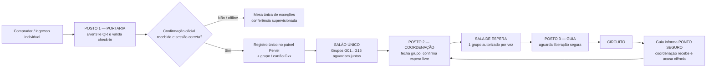

# ARQUITETURA OPERACIONAL — TRÊS POSTOS, DOIS PORTÕES E UM CIRCUITO
**Casa do Julgamento 2026 | 16/10/2026 | VERSÃO PARA REVISÃO — não implementada em produção**

## 1. Contexto e decisões preservadas
Site público simples: ibpeniel.com. Venda, ingressos e leitura de QR por plataforma externa candidata Even3, ainda sujeita a testes/contratação. Painel operacional Peniel separado do financeiro. Há seis sessões (09,13,14,19,20,21/11). A hora informada ao público é de **abertura dos portões**. Máximo comercial de **300 pessoas/sessão = 15 grupos x 20**, previsão de 210 online + 90 presencial, sujeito à confirmação logística e jurídica. Todos aguardam inicialmente num **SALÃO ÚNICO**, mesmo que pertençam a grupos diferentes. Uma **SALA DE ESPERA** recebe um grupo por vez. O **CIRCUITO** recebe o grupo após autorização física. A lotação real da sala de espera, gargalos, percurso e intervalos carecem de ensaio.

## 2. Desenho físico e digital

Os locais são conceptuais até a vistoria da igreja. A comunicação de ponto seguro deve respeitar a realidade física, não apenas o timer.

## 3. Três painéis independentes — login próprio e mínimo privilégio

### /operacao/portaria
**Vê:** sessão ativa, estado da conexão Even3, total de check-ins confirmados, fila de sincronização atrasada, última confirmação e encaminhamento para grupo, solicitações pendentes, alerta vermelho de duplicidade/sessão errada.
**Faz:** usa APP OFICIAL Even3 para scan; consulta estado confirmado no painel; comunica grupo físico Gxx; chama supervisor para exceção; faz conferência manual somente no protocolo de contingência.
**Não faz:** marcar pago, forçar check-in, liberar sala de espera/circuito, acessar relatórios financeiros.
**Mensagem objetiva pós-scan:** "CONFIRMADO NA EVEN3 / SINCRONIZADO COM PENIEL / GRUPO G03 / SALÃO". Se a Even3 validar mas Peniel não receber, exibir "AGUARDANDO SINCRONIZAÇÃO": não fingir que o envio foi bem-sucedido. Usar entrega manual controlada com ID único e registro de reconciliação; equipe de salão acusa recebimento. Nome sozinho não prova ingresso.

### /operacao/coordenacao
**Vê:** número de confirmados/aguardando por sessão, mapa dos 15 grupos, pessoas fisicamente no salão, sala de espera ocupada/vazia, grupos no circuito, confirmação de ponto seguro, último sinal e horário, operador titular/substituto, alertas sem resposta.
**Faz:** fechar grupo com 1 a 20 (20 é TETO e NÃO mínimo), designar guia, enviar grupo do salão para sala de espera, autorizar partida somente com condições verificadas, pausar fluxo, executar transferência formal para substituto.
**Não faz:** aceitar check-in sem evidência, ignorar segurança física para compensar atraso; duas coordenações não podem autorizar ao mesmo tempo.

### /operacao/guia
**Vê:** apenas grupo designado, quantidade, localização prevista (sala de espera/circuito), estado operacional, instruções de segurança, sinal da coordenação, confirmação de que o grupo anterior chegou a ponto seguro quando aplicável.
**Faz:** aceitar grupo entregue pela coordenação, sinalizar PRONTO, solicitar autorização, confirmar INICIOU_CIRCUITO, emitir PONTO_SEGURO e FINALIZOU; sinalizar INCIDENTE/PARAR e exigir ACK.
**Não faz:** emitir ingresso, reatribuir participantes após saída, liberar grupo seguinte unilateralmente, ver dados financeiros.

## 4. Estados separados por entidade
INGRESSO/PORTARIA: NAO_VALIDADO → CHECKIN_CONFIRMADO_EVEN3 → CHECKIN_SINCRONIZADO_PENIEL → ALOCADO / EXCECAO. Em check-in offline, status específico PENDENTE_DE_SINCRONIZACAO e operação somente por contingência aprovada. Proibir 2 chegadas para mesmo (provedor,evento,sessao,ingresso).
GRUPO: ABERTO_NO_SALAO → FECHADO_NO_SALAO (pode ter menos de 20) → CHAMADO_SALA_ESPERA → CONFIRMADO_NA_ESPERA → LIBERADO_PARA_CIRCUITO → EM_CIRCUITO → PONTO_SEGURO → CONCLUIDO. Suspensão/incidente é estado transversal. Nunca saltar etapas. Reabrir grupo fechado só pela coordenação e antes de chamar para espera, com auditoria.
SALA DE ESPERA: VAZIA / RESERVADA_Gxx / OCUPADA_Gxx / ESVAZIANDO / BLOQUEADA. Não admitir simultaneamente outro grupo sem confirmação física de vazio.
AUTORIZAÇÃO: SOLICITADA → CONFERIDA → AUTORIZADA (por pessoa/ato humano) → RECEBIDA_PELO_GUIA → EXECUTADA. Registro de quem, quando e motivo.

## 5. Regras de despacho e sincronismo
P1: somente participante de sessão correta e check-in confirmado ou exceção manual supervisionada entra no salão.
P2: grupo até 20; família junta quando couber; a família que não cabe vai ao próximo, nunca ultrapassando limite. Grupos podem ser fechados abaixo de 20 por decisão da coordenação.
P3: passar salão → sala de espera exige grupo fechado, sala de espera livre, guia/apoio prontos, caminho seguro, autorização da coordenação e confirmação presencial de chegada. A coordenação só pode liberar um grupo por vez.
P4: passar espera → circuito exige comunicação de PONTO_SEGURO anterior ou condição inaugural explicitamente definida, guia identificado, coordenação autorizando a operação, via livre e ACK entre postos.
P5: nenhum cronômetro libera automaticamente. Relógio é alerta para checagem.
P6: qualquer incidente, dúvida, perda de rádio, ausência de ACK, bloqueio de rota ou ausência de coordenador ativa PAUSAR NOVAS LIBERAÇÕES até substituição formal / confirmação de segurança. Grupos já dentro do circuito seguem protocolo humano de emergência.
P7: O substituto da coordenação é escalado antes de abrir o portão, vê as mesmas informações, mas só assume após registro de transferência de comando. Só 1 autoridade ativa por sessão.
P8: incidentes, autorizações e transferências ficam auditadas no banco; backups e papel em modo de contingência.

## 6. Sinais de comunicação obrigatórios
Formato falado por rádio: "[posto] → [posto] | sessão/dia | grupo | evento | hora | confirmação de recebimento".
Ex.: "Guia G01 para Coordenação, PONTO SEGURO confirmado, 20:22. Câmbio"; resposta: "Coordenação recebeu G01 ponto seguro 20:22; aguarde liberação".
Ex.: "Coordenação para Sala de Espera, G02 AUTORIZADO PARA RECEBER, confirme sala vazia"; resposta: "Espera pronta, G02 pode entrar".
Ex.: "Coordenação para Guia G02, AUTORIZADO INICIAR, via liberada"; guia responde "G02 RECEBIDO, INICIANDO, 20:25".
No sistema: cada mensagem com event_id/sequence, session_id/group_id, role/operator, sent_at, acknowledged_at, status; alertas por timeout configurável, mas SEM transformação automática de ausência de resposta em autorização.

## 7. Cenários não negociáveis
A: QR confirmado Even3 e atraso de webhook → não alegar que sincronizou; organizar conferência supervisionada.
B: Even3 offline em algum celular → sistema Peniel não sabe em tempo real; controle físico de transferências de pessoas com ID e reconciliação.
C: coordenador ausente → substituir formalmente; PAUSA provisória de novas partidas; nenhum guia inventa liberação.
D: guia informa PONTO SEGURO, mas sala de espera ocupada → NÃO mover novo grupo; liberar somente ao resolver ocupação.
E: grupo G03 com 8 pessoas → pode FECHAR com 8, enviar para espera quando autorizado, iniciar quando circuito seguro.
F: dois scans do mesmo ticket, eventos webhook duplicados → uma única entrada/uma única posição em grupo.
G: 18 vagas ocupadas num grupo, família de quatro chega → família vai ao próximo grupo.
H: emergência física → STOP imediato, intervenção de responsáveis no local.

## 8. Questões a levar à reunião
Q01 A sala de espera comporta um grupo inteiro de 20 com acessibilidade e saída segura?
Q02 Onde está o PONTO SEGURO, quem o atesta e qual a distância real entre grupos?
Q03 O guia que acompanha o grupo é o mesmo que libera a próxima entrada? Se não, definir GUIA DA ESPERA e GUIA DO CIRCUITO, sem ambiguidades.
Q04 Quem é coordenador titular e substituto? Quem segura o posto durante almoço/falhas?
Q05 Como se identifica que todos os integrantes Gxx chegaram fisicamente à espera?
Q06 Qual é o protocolo para mobilidade reduzida, atrasos, menores e famílias?
Q07 Os 15 grupos x20 e a reserva 210/90 foram confirmados em laudo operacional? Existe documento antigo falando 20–21; NOVA PROPOSTA limita a 20 e não altera decisão por conta própria.
Q08 Qual o intervalo operacional real e tolerância? Quem mede presencialmente?
Q09 Que rádios, internet redundante, baterias e cartões são disponibilizados?
Q10 Quem audita a lista de entradas manuais e o fechamento da sessão?

## 9. Situação
DESENHO DOCUMENTADO, NÃO DESENVOLVIMENTO EM PRODUÇÃO. Painel atual em /prototipos/painel-operacional-v1 é simulação num navegador único, sem RBAC, sem sincronização entre postos, sem Even3. Não usar para evento real.

## Fontes e referências
Documento mestre e IA-011 da Igreja (origem das seis sessões, teto, grupos e segurança).
Even3 check-in por QR e offline: https://ajuda.even3.com.br/hc/pt-br/articles/28347076996251-Como-utilizar-o-App-Even3-credenciamento
Even3 webhooks: https://developers.even3.com/gatilhos-de-participantes-2281973m0