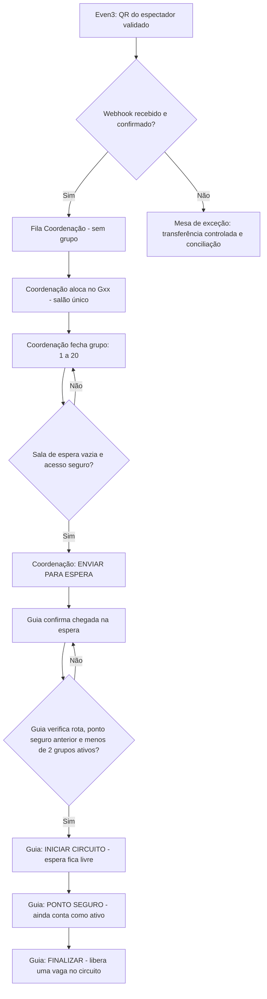

# Casa do Julgamento 2026 — Fluxo operacional V3 e decisões de homologação

**Data:** 16/10/2026  
**Estado:** proposta operacional e simulador de treinamento; **não é produção, não aceita pagamentos, não lê QR real.**  
**Site oficial:** `www.ibpeniel.com` permanece com design simples, sem alteração.  
**Demonstração:** `https://casadojulgamento.vercel.app/prototipos/operacao-fluxo-v3/`.

## Alterações solicitadas pela coordenação

- Painéis/visões separados: **Portaria e bilheteria**, **Coordenação**, **Guia**, e **Telão do salão** (somente leitura).
- A Portaria **não aloca grupos**. Quando um check-in é confirmado na Even3 e sincronizado, a pessoa aparece na **fila da Coordenação**. Na simulação, um botão imita esse resultado; **não há webhook nem leitor verdadeiro**.
- A Coordenação escolhe o grupo, mantém famílias juntas quando houver capacidade, pode **fechar com 1 a 20 pessoas**, e executa o botão **Enviar para espera** (em vez de Chamar espera).
- A **sala de espera só comporta um grupo por vez**. Estado **RESERVADA/OCUPADA** começa quando o coordenador envia o grupo, até o **Guia confirmar início no circuito**. A tela da Coordenação só mostra **VAZIA** depois dessa confirmação. A inspeção física é obrigatória: tela não basta para segurança.
- O Guia **não solicita autorização eletrônica** ao coordenador para iniciar ou encerrar. Ele confirma chegada à espera, **Iniciar circuito**, **Ponto seguro** e **Finalizar** sob a responsabilidade operacional designada. Antes de iniciar, deve conferir as condições físicas da rota e a comunicação de segurança.
- **No máximo 2 grupos ocupam o circuito simultaneamente**. O grupo que já atingiu o **ponto seguro continua contando como presente no circuito** até o Guia marcá-lo como **FINALIZADO**. Assim, nunca poderão constar três grupos ativos.
- O **segundo grupo pode iniciar** se o grupo anterior estiver em ponto seguro (ou finalizado) e houver menos de 2 grupos ativos. O terceiro precisa aguardar a **finalização** de pelo menos um dos dois, além das demais condições.
- **Telão do salão único** mostra, sem nomes nem dados pessoais, o grupo enviado/ocupando a espera e o grupo seguinte em formação, com número de pessoas. Será somente leitura no sistema real.

## Fluxo de estados

**Tela de circuito do coordenador:** indicadores VERDE para **EM PERCURSO** e **PONTO SEGURO**, status FINALIZADO histórico; contador de ocupação **0/2, 1/2 ou 2/2**. O atraso de mensagem deve produzir aviso, nunca autorização presumida.

## Autoridade e falha de comunicação

A Coordenação não autoriza cada início, mas mantém autoridade de **PAUSAR MOVIMENTOS** e ativar procedimento de emergência. Cada Guia precisa receber/confirmar o estado de segurança do grupo anterior, presencialmente ou por rádio. Qualquer posto pode comunicar **PARAR** por risco, e o Guia não deve entrar se não souber com segurança o estado da rota ou dos grupos ativos. Um **substituto de coordenação** deve estar escalado; a transferência de turno deve ser explícita, com um só coordenador ativo, logada na versão real. O protótipo só simula troca e pausa; não autentica pessoas.

## Venda presencial — fluxos propostos, ainda sujeitos à aprovação da Even3

**Duas operações no Posto 1, preferencialmente dois atendentes/filas separados:**

1. **Credenciamento expresso**: leitor oficial Even3 confere QR e sessão; webhook ou transferência supervisionada coloca pessoa na fila da Coordenação.
2. **Bilheteria física**: confirma que a cota PRESENCIAL de 90 entradas dessa sessão permanece disponível na mesma fonte oficial; coleta dados mínimos obrigatórios da plataforma; registra a cobrança por meio aprovado e a inscrição nominal na Even3; só entrega QR e permite check-in **depois da confirmação financeira**. A inclusão manual de participante por si só **não comprova pagamento**.
3. Quando a entrada presencial é validada pelo leitor Even3, a **mesma** integração insere a pessoa na **fila da Coordenação**, com marcação do canal `presencial`; não há fluxo paralelo nem dois bancos autônomos.
4. Se a Even3 não suportar cobrança/pagamento à porta como necessário, documentar procedimento da igreja para recibo, caixa, inscrição e reconciliação com aprovação do financeiro e da plataforma. Nunca gerar QR “caseiro” incompatível com o leitor oficial.
5. Bloquear vendas se o estoque ou a confirmação financeira não puder ser verificada. Protocolo de exceção com supervisor, não “dar entrada” automaticamente.

**Fonte Even3:** https://ajuda.even3.com.br/hc/pt-br/articles/360016419832-Inscrever-um-participante-manualmente (declara que cadastrar participante não garante pagamento).  
**Configuração de categorias e quotas:** https://ajuda.even3.com.br/hc/pt-br/articles/212181346-Cadastrar-entradas-para-a-inscri%C3%A7%C3%A3o-no-meu-evento.  
**Check-in geral apenas uma vez por evento:** https://ajuda.even3.com.br/hc/pt-br/articles/29254959740059-Realizar-o-credenciamento-dos-participantes.  
**Webhook check-in:** https://developers.even3.com/gatilhos-de-participantes-2281973m0.

### Perguntas obrigatórias à Even3

1. Qual a melhor configuração para **seis sessões** separadas, QR por espectador e check-in de sessão correta?
2. Há como vender **presencialmente na hora** na mesma conta/cota, com dinheiro/PIX/maquininha externa e confirmação transparente no relatório? Qual módulo/preço?
3. Podemos reservar até **210 vagas online + 90 presenciais por sessão**, sem estourar **300 totais**?
4. Inscrição manual com pagamento presencial: como reconciliar e gerar ingresso/QR válido sem alegar falsamente pagamento automático?
5. Webhook de check-in: documentação do payload efetivo, autenticação, alcance dos eventos, preço por API e funcionamento quando app sincronizar entradas offline.
6. Como exportar os registros confirmados por sessão e a lista de check-ins para contingência e impressão com carimbo de atualização?

## Tarefas técnicas ainda abertas

- Implantar backend privado, banco PostgreSQL, `tickets`, `checkins`, `groups`, `group_members`, `ops_events`, `operator_roles`, `onsite_receipts` e auditoria. **Não guardar dados pessoais no GitHub público**.
- Proteger invariantes **em transação no servidor**, não apenas nos botões: um ingresso somente uma entrada; sala de espera no máximo 1; 0–2 grupos ativos; grupos até 20; um responsável por sessão; transições válidas; não reabrir encerrado.
- Conectar webhook autenticado Even3, idempotência/duplicatas, reconciliação periódica, alertas de atraso, fallback supervisor. Validar dados de participante e sessão antes de confiar nos eventos recebidos.
- Atualização entre celulares em tempo real (o protótipo sincroniza apenas abas do mesmo navegador), login e permissão para cada posto, painel telão somente leitura e alertas operacionais.
- Ensaiar sensores humanos/rádio: saída física da espera, duas posições do circuito, ponto seguro, finalização, comunicação e regras de evacuação.
- Contingência: lista oficial exportada pela Even3 por sessão, hora de corte, complemento de vendas posteriores, posto único de conferência, cartões G01–G15, reconciliação, acesso restrito e LGPD.

## Testes automatizados no protótipo V3

**Aprovados em ambiente de lógica simulada, usando Node VM:** check-in fica na fila da Coordenação (sem grupo); grupo fecha com 1/20; Espera exclusiva; Guia inicia sem autorização digital; segundo grupo bloqueado até ponto seguro anterior; terceiro grupo bloqueado mesmo com dois no ponto seguro; terceira partida liberada após finalização de um dos dois; venda presencial fictícia não é validada automaticamente. **Não há teste visual de navegador externo nem sincronização real entre aparelhos.**

## Deliberações pendentes para reunião da equipe

- Confirmar presencialmente se a **espera recebe um grupo** e o circuito comporta **até dois grupos**, exatamente como solicitado.
- Definir se existe um guia da espera distinto do guia de circuito e quem confirma que a sala de espera esvaziou fisicamente.
- Confirmar que o Guia tem autoridade para **decidir saída do grupo**, sob regras de segurança da coordenação, e como funcionará sinalização/rádio.
- Designar titular e substituto da Coordenação e um procedimento para silêncio de rádio/perda de conexão.
- Definir filas e equipe para credenciamento e venda presencial; responsabilidades financeiras e fiscalização da cota 90.
- Validar na Even3 sessões, webhooks, modalidade de venda presencial e custo antes de abrir pagamento.

**Documentação anterior com regra de “guia pede autorização ao coordenador” fica SUPERADA por esta PROPOSTA V3, aguardando validação final da coordenação e teste físico.**